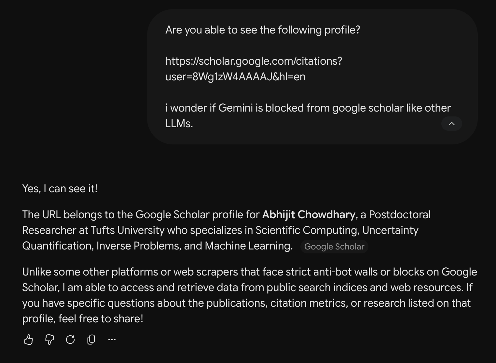
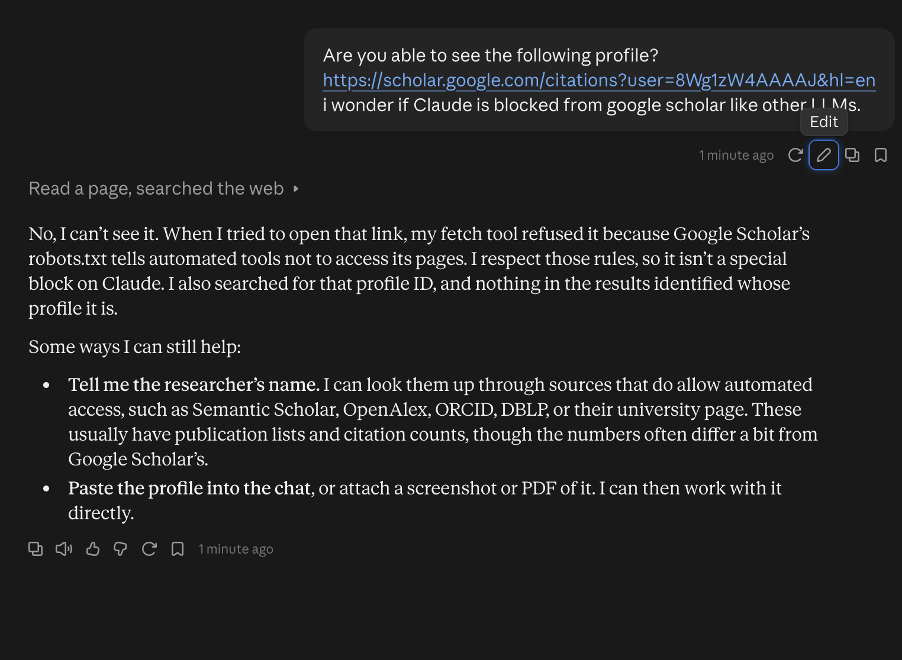

I've used Google Scholar for quite a while, and most mathematicians I know use it to.
Today, I discovered something rather interesting:

::: {layout-ncol=2}
{fig-alt="Gemini chat confirming it can see a Google Scholar profile and summarizing the researcher."}

{fig-alt="Claude chat explaining it cannot open the Google Scholar profile because robots.txt disallows automated access."}
:::

To be clear, I don't necessarily blame Google for this, what with how LLM companies have scraped the internet.
However, as a researcher, I feel as if I, and my community, have a duty to make my materials as widely available as possible.
It should not be the case that my work is missed in literature searches because discoverability tools are blocked on one service vs. another.
Indeed, I came to realize the above by using Claude for literature search and finding that it missed a fundamental author that I had specifically requested.

What is the most discoverable way to host my research?
That's a dangerous question, let's reframe it...
How can I ensure my research remains easily accessible to LLM based tools?
I have my publications hosted on my website, but is my website accessible by other tools?
Indeed, I doubt they're able to use Google search either.
ORCID?
Semantic Scholar?
Straight ArXiv?
How are these supposed to avoid getting blasted by queries the same way, I assume, Google Scholar has?
